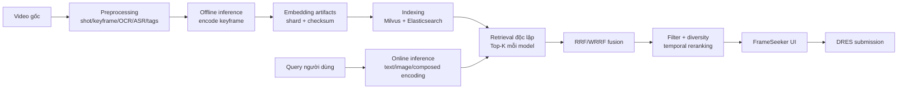
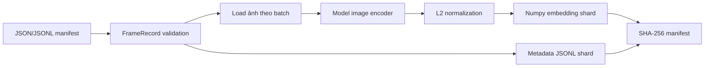
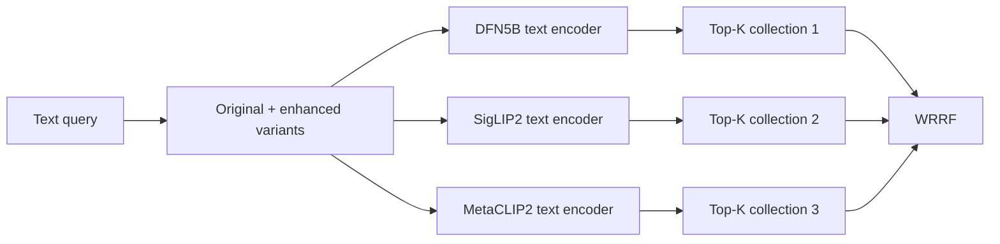

# BÁO CÁO KỸ THUẬT INFERENCE + ENSEMBLE

**Dự án:** FrameSeeker — AI Challenge 2026  
**Phạm vi:** Offline image inference, online query inference, multi-model retrieval, rank fusion, temporal retrieval và đánh giá ensemble  
**Ngày cập nhật:** 21/07/2026  
**Trạng thái:** Hoàn thành implementation; chờ dataset chính thức để tạo gallery đa mô hình và tuning trên validation set

---

## 1. Tóm tắt điều hành

Phần Inference + Ensemble của FrameSeeker đã được thiết kế và triển khai thành một pipeline hoàn chỉnh, có khả năng:

1. Chuẩn hóa manifest keyframe và định danh thống nhất một frame giữa nhiều mô hình.
2. Encode toàn bộ keyframe bằng một hoặc nhiều mô hình image-text dual encoder.
3. Lưu embedding theo shard có checksum, hỗ trợ resume và kiểm tra toàn vẹn.
4. Nạp mỗi gallery embedding vào một Milvus collection riêng.
5. Encode text query, image query hoặc composed text-image query ở thời gian truy vấn.
6. Lấy Top-K độc lập từ từng mô hình và từng query variant.
7. Hợp nhất các ranking bằng Reciprocal Rank Fusion hoặc Weighted RRF.
8. Lọc theo tags, OCR, ASR; giảm kết quả trùng gần nhau; giới hạn số frame trên mỗi video.
9. Xử lý chuỗi nhiều BoxQuery theo thứ tự thời gian trong cùng video.
10. Đánh giá Recall@K, MRR, mAP và chạy ablation trên mọi tập con mô hình.
11. Trả đúng `video_id`, `frame_idx`, timestamp và hỗ trợ gửi kết quả tới DRES.

Kết luận về trạng thái hiện tại:

- **Mã nguồn và kiến trúc Inference + Ensemble:** hoàn thành.
- **Baseline DFN5B:** đã bật trong cấu hình.
- **SigLIP2 và MetaCLIP2:** adapter và cấu hình đã có, nhưng đang tắt có chủ đích.
- **Ensemble đa mô hình trên dữ liệu thi thật:** cần encode đủ gallery cho các mô hình bổ sung, nạp Milvus và bật chúng trong cấu hình.
- **Trọng số ensemble cuối cùng:** phải được chọn bằng validation/ablation, không nên đoán thủ công.

---

## 2. Vị trí trong pipeline tổng thể



Phân chia trách nhiệm:

| Khối | Nội dung | Phân loại |
|---|---|---|
| Video → keyframe | Chia shot, chọn keyframe | Preprocessing |
| Keyframe → embedding | Encode toàn bộ ảnh trước cuộc thi | Offline inference, thường chạy cùng giai đoạn preprocessing |
| Embedding → Milvus | Tạo gallery ANN theo từng model | Indexing |
| Query → embedding | Encode query trong lúc thi | Online inference |
| Top-K từng model | Vector retrieval | Retrieval |
| RRF/WRRF | Kết hợp các ranking | Ensemble/Fusion |
| Temporal/diversity/filter | Hậu xử lý kết quả | Post-retrieval/Reranking |
| mAP/Recall/MRR | So sánh cấu hình | Evaluation/Experimentation |

---

## 3. Kiến trúc đã triển khai

### 3.1. Thành phần chính

| Thành phần | Trách nhiệm | File chính |
|---|---|---|
| Model Registry | Đọc cấu hình, lazy-load/unload model, quản lý adapter | `apps/api/app/services/model_registry.py` |
| Embedding Artifact | Chuẩn hóa frame, ghi shard, checksum, resume | `apps/api/app/services/embedding_artifacts.py` |
| Offline Encoder | Encode keyframe theo batch và từng model | `apps/api/scripts/embed_keyframes.py` |
| Milvus Loader | Preflight và upsert gallery vào collection | `apps/api/scripts/load_ensemble_embeddings.py` |
| Ensemble Search | Text/image/composed inference và tạo ranking sources | `apps/api/app/services/ensemble_search.py` |
| Fusion | RRF/WRRF và diversity | `apps/api/app/services/fusion.py` |
| Hybrid Search | Filter, metadata enrichment và temporal search | `apps/api/app/services/hybrid_search.py` |
| Milvus Backend | Truy vấn đúng collection của từng model | `apps/api/app/services/milvus_client.py` |
| Evaluation | Recall@K, MRR, mAP và ablation | `apps/api/app/evaluation/` |
| DRES | Đăng nhập và gửi KIS/QA/track | `apps/api/app/services/dres.py` |

### 3.2. Nguyên tắc kiến trúc

- Mỗi model có **image tower và text tower tương ứng**.
- Không so sánh text embedding của model A với image embedding của model B.
- Mỗi model có **một gallery hoàn chỉnh và một Milvus collection riêng**.
- Các model được kết hợp ở **ranking level**, không nối hoặc cộng trực tiếp embedding khác không gian.
- `frame_uid` là khóa chung để hợp nhất cùng một frame giữa các ranking.
- Model chỉ được bật sau khi collection của nó chứa cùng tập frame chuẩn với các model còn lại.
- Model được lazy-load để không chiếm GPU memory khi chưa sử dụng.
- Mặc định chỉ dùng một Gunicorn worker để tránh nhân bản model trong VRAM.

---

## 4. Cấu hình mô hình hiện tại

Nguồn cấu hình: `apps/api/config/ensemble.json`.

| Model ID | Adapter | Checkpoint/model | Dimension | Milvus collection | Weight | Trạng thái |
|---|---|---|---:|---|---:|---|
| `dfn5b` | OpenCLIP | `ViT-H-14`, pretrained `dfn5b` | 1024 | `data_frames` | 1.0 | Bật |
| `siglip2-so400m-384` | Hugging Face | `google/siglip2-so400m-patch14-384` | 1152 | `data_frames_siglip2_so400m_384` | 1.0 | Tắt |
| `metaclip2-worldwide-huge` | Hugging Face | `facebook/metaclip-2-worldwide-huge-quickgelu` | 1024 | `data_frames_metaclip2_worldwide_huge` | 1.0 | Tắt |

Các revision Hugging Face đã được pin để tăng tính tái lập. Trước khi bật MetaCLIP2 cần kiểm tra lại điều kiện sử dụng checkpoint vì cấu hình hiện tại có ghi chú giấy phép phi thương mại.

### 4.1. Trạng thái ensemble thực tế

Hạ tầng multi-model đã hoàn chỉnh, nhưng khi chỉ `dfn5b` được bật thì hệ thống đang vận hành như single-model baseline đi qua cùng một fusion engine. RRF bắt đầu tạo lợi ích đa mô hình sau khi ít nhất một gallery bổ sung được encode, nạp đầy đủ và bật.

---

## 5. Canonical Frame Identity

Một frame có ba chỉ số khác nhau và không được dùng lẫn:

| Trường | Ý nghĩa |
|---|---|
| `frame_index` | Số thứ tự của ảnh keyframe được trích xuất, thường lấy từ tên file |
| `frame_idx` | Chỉ số frame trong video gốc do metadata cung cấp; dùng cho submission |
| `pts_time` | Timestamp chính thức theo giây |

Khóa hợp nhất được tạo theo định dạng:

```text
frame_uid = <video_id>:<frame_index được pad 8 chữ số>
```

Ví dụ:

```text
L21_V001:00000007
```

Pipeline ưu tiên `frame_idx` từ metadata. Chỉ suy ra `timestamp × fps` khi nguồn không cung cấp `frame_idx` và video chắc chắn có constant frame rate. `youtube_url` hoặc alias `watch_url` cũng được bảo toàn xuyên suốt artifact và Milvus.

---

## 6. Offline inference: tạo embedding gallery

### 6.1. Input manifest

Khuyến nghị JSONL để stream dataset lớn. Một record điển hình:

```json
{
  "file_path": "keyframes/L21/L21_V001/0007.webp",
  "video_path": "keyframes/L21/L21_V001",
  "youtube_url": "https://www.youtube.com/watch?v=example",
  "keyframe_info": {
    "frame_idx": 180,
    "shot_idx": 3,
    "start_time": 5.0,
    "end_time": 7.0,
    "pts_time": 6.0,
    "fps": 30.0
  },
  "OD_tags": ["person"],
  "RAM_tags": ["street"]
}
```

### 6.2. Luồng xử lý



Model được xử lý tuần tự để phù hợp GPU nhỏ. Sau khi hoàn thành một model, registry unload model đó trước khi tải model kế tiếp.

Lệnh mẫu trên Windows/PowerShell:

```powershell
cd apps/api
uv run python scripts/embed_keyframes.py --input ../../data/manifests/frames.jsonl --images-root ../../data --output ../../data/ensemble-embeddings --model dfn5b --batch-size 64 --shard-size 10000
```

Tiếp tục job bị gián đoạn:

```powershell
uv run python scripts/embed_keyframes.py --input ../../data/manifests/frames.jsonl --images-root ../../data --output ../../data/ensemble-embeddings --model dfn5b --batch-size 64 --shard-size 10000 --resume
```

### 6.3. Cấu trúc artifact

```text
ensemble-embeddings/<model-id>/
  manifest.json
  embeddings-00000.npy
  records-00000.jsonl
  embeddings-00001.npy
  records-00001.jsonl
```

`manifest.json` chứa:

- Artifact version và trạng thái complete.
- Model ID, adapter, model name, pretrained, revision.
- Embedding dimension, collection và text preprocessing.
- Tổng số frame.
- Danh sách shard, số record và SHA-256 của từng file.

### 6.4. Cơ chế an toàn

- Không ghi đè thư mục artifact không rỗng nếu không có `--resume`.
- Resume chỉ được phép khi model identity và preprocessing khớp hoàn toàn.
- Kiểm tra shape embedding đúng `(batch_size, dimension)`.
- Từ chối `NaN` và `Inf`.
- Từ chối `frame_uid` trùng trong batch, shard hoặc toàn artifact.
- Manifest được cập nhật qua file tạm rồi replace để giảm nguy cơ hỏng khi gián đoạn.
- Mỗi shard hoàn thành là một checkpoint bền vững.

---

## 7. Indexing vào Milvus

Mỗi model sử dụng collection riêng vì dimension và không gian embedding khác nhau.

### 7.1. Dry-run bắt buộc khuyến nghị

```powershell
cd apps/api
uv run python scripts/load_ensemble_embeddings.py ../../data/ensemble-embeddings/dfn5b/manifest.json --dry-run
```

### 7.2. Nạp dữ liệu

```powershell
uv run python scripts/load_ensemble_embeddings.py ../../data/ensemble-embeddings/dfn5b/manifest.json --insert-batch-size 2000
```

Loader thực hiện toàn bộ preflight trước khi sửa collection:

- Artifact phải `complete=true`.
- Model identity trong artifact phải khớp cấu hình.
- Kiểm tra checksum mọi shard.
- Kiểm tra dimension, số record, finite values và duplicate.
- Kiểm tra giới hạn độ dài metadata của Milvus.
- Kiểm tra canonical schema.

`--recreate` có khả năng xóa collection đích. Chỉ dùng sau khi đã dry-run, backup và xác nhận chính xác tên collection. Thiết kế an toàn hơn là nạp vào collection mới, kiểm thử, sau đó đổi cấu hình.

---

## 8. Online inference và retrieval

### 8.1. Text query



Các bước:

1. Validate query và ensemble options.
2. Giữ original query; tạo enhanced query nếu bật enhancement.
3. Encode các variant bằng text tower của từng model.
4. Cache embedding text bằng LRU thread-safe, mặc định tối đa 512 entry.
5. Truy vấn `candidate_top_k` trong collection tương ứng.
6. Tạo một ranking source cho mỗi cặp model-query variant.
7. Chia đều tổng trọng số model cho các variant để query enhancement không tự nhân đôi ảnh hưởng model.
8. Fusion, diversity, filtering và metadata enrichment.

Mặc định quan trọng:

| Tham số | Giá trị |
|---|---:|
| Final Top-K | 20 |
| Candidate Top-K | 200 |
| RRF `k` | 60 |
| Preserve original query | Có |
| Partial model tolerance | Có |
| Text embedding cache | 512 entry |

### 8.2. Image query

Ảnh query được encode riêng bằng image tower của từng model. Mỗi embedding chỉ truy vấn collection cùng model, sau đó các ranking được hợp nhất bằng WRRF.

### 8.3. Composed image-text retrieval

Với mỗi model `m`, text và ảnh được kết hợp trong chính joint embedding space của model đó:

```text
z_m = normalize(α × text_embedding_m + (1 - α) × image_embedding_m)
```

Trong đó `α = 0.75` là baseline. Sau khi chuẩn hóa L2, `z_m` truy vấn gallery của model `m`. Các ranking composed của các model sau đó mới được fusion.

Thiết kế này phù hợp với quy trình relevance feedback: người dùng chọn một frame gần đúng rồi bổ sung câu mô tả phần cần thay đổi.

---

## 9. Ensemble bằng RRF/WRRF

### 9.1. Công thức

Với frame `d`, tập ranking sources `S`, trọng số source `w_s`, rank của frame trong source `r_s(d)` và hằng số `k`:

```text
WRRF(d) = Σ [w_s / (k + r_s(d))]
          s∈S
```

Baseline sử dụng `k = 60`.

### 9.2. Lý do chọn rank fusion

- Cosine/IP score giữa các model không cùng thang đo.
- Không cần calibration score phức tạp trước khi có validation set.
- Một frame xuất hiện cao trong nhiều ranking sẽ được tăng hạng tự nhiên.
- Chịu được ranking thiếu hoặc một optional model tạm lỗi.
- Có thể đo đóng góp từng model bằng ablation.

### 9.3. Xử lý duplicate và diagnostics

- Một frame chỉ đóng góp một lần trong mỗi source, theo rank đầu tiên.
- Các source được hợp nhất qua `frame_uid`.
- Kết quả giữ `fusion_score`, `model_ranks` và `model_scores` để debug.
- Tie được xử lý xác định để kết quả có tính tái lập.

### 9.4. Trọng số

Baseline để tất cả model ở `1.0`. Không tăng trọng số chỉ dựa trên cảm giác. Trọng số mới chỉ được promote khi cải thiện trên held-out validation set và không làm giảm mạnh một lớp query quan trọng.

---

## 10. Post-retrieval

### 10.1. Metadata filtering

Hệ thống hỗ trợ:

- Tags với chế độ `and` hoặc `or`.
- Keyword từ OCR, ASR hoặc cả hai.
- Keyword mode `and` hoặc `or`.
- Over-fetch candidate khi có filter để tránh thiếu kết quả sau lọc.
- Batch enrichment metadata từ Elasticsearch, giữ nguyên thứ tự fusion.

### 10.2. Diversity

Sau fusion có thể:

- Loại các frame cùng video nằm quá gần nhau theo `diversity_time_seconds`.
- Giới hạn `max_per_video`.
- Giữ thứ tự score trong khi chọn đủ số kết quả cuối.

Điều này giảm tình trạng Top-K bị chiếm bởi nhiều keyframe gần như giống nhau trong cùng một đoạn video.

### 10.3. Temporal multi-box search

Mỗi BoxQuery phải có đúng một nguồn: text hoặc image. Hệ thống:

1. Retrieval riêng cho từng BoxQuery.
2. Gom candidate theo `video_id`.
3. Dùng dynamic programming để tìm chuỗi frame theo đúng thứ tự query.
4. Bắt buộc các frame tăng theo thời gian.
5. Giới hạn toàn chuỗi trong `temporal_window_seconds`, mặc định 120 giây.
6. Hợp nhất và xếp hạng các sequence tốt nhất.

Đây là phần phục vụ query mô tả nhiều hành động liên tiếp thay vì chỉ một hình ảnh độc lập.

---

## 11. API phục vụ inference

| Endpoint | Chức năng |
|---|---|
| `POST /api/search` | Text retrieval + ensemble + filter |
| `POST /api/search/image` | Image retrieval + ensemble |
| `POST /api/search/composed` | Composed image-text retrieval |
| `POST /api/frames` | Multi-box temporal retrieval |
| `POST /api/search/similar` | Tìm frame tương tự từ frame đã chọn |
| `POST /api/search/video` | Liệt kê frame trong một video/window |
| `GET /api/keyframes/<video_id>/<frame_index>` | Phục vụ ảnh keyframe |
| `GET /api/health` | Kiểm tra Milvus, Elasticsearch và model collections |
| `POST /api/dres/login` | Đăng nhập DRES phía server |
| `POST /api/dres/submit/<type>` | Gửi KIS, QA hoặc track submission |

Ví dụ text search:

```json
{
  "text": "a person drops a pink bear keychain near a fruit stall",
  "topk": 20,
  "enhance": true,
  "ensemble": {
    "candidate_topk": 500,
    "rrf_k": 60,
    "preserve_original_query": true,
    "diversity_time_seconds": 2.0,
    "max_per_video": 5,
    "allow_partial_models": true
  }
}
```

Response giữ `results` để tương thích frontend và có `meta` chứa:

- Query variants.
- Model/source đã chạy.
- Candidate Top-K và RRF k.
- Lỗi từng optional model nếu có.

---

## 12. Failure policy và tính an toàn

### 12.1. Online inference

Mặc định `allow_partial_models=true`:

- Nếu một optional model lỗi, hệ thống ghi lỗi vào `meta.errors`.
- Ranking từ các model khỏe vẫn được fusion và trả về.
- Nếu mọi model đều lỗi, request thất bại rõ ràng.

Trong evaluation nên đặt `allow_partial_models=false` để thiếu model/collection không bị che khuất.

### 12.2. Validation đầu vào

- Giới hạn Top-K và candidate Top-K.
- Từ chối weight âm, vô hạn hoặc NaN.
- Từ chối cấu hình mọi model có weight bằng 0.
- Từ chối model ID hoặc weight không thuộc tập model được chọn.
- Composed `text_weight` phải trong `[0, 1]`.
- Base64/image không hợp lệ trả lỗi 4xx có cấu trúc.
- BoxQuery phải có đúng text hoặc image.
- Timestamp, FPS và metadata số phải hữu hạn, không âm.

### 12.3. Offline/indexing

- Không cho collection cũ có dimension sai được dùng âm thầm.
- Legacy auto-ID schema không được nạp bằng loader mới nếu chưa migration rõ ràng.
- Toàn artifact được preflight trước khi `--recreate` có thể drop collection.
- Checksum, duplicate, shape và model identity được kiểm tra lại khi load.

---

## 13. Evaluation và kiến trúc thí nghiệm

### 13.1. Metrics

| Metric | Ý nghĩa |
|---|---|
| Recall@1 | Tỷ lệ query có đáp án đúng ở vị trí đầu tiên |
| Recall@5 | Tỷ lệ query có ít nhất một đáp án đúng trong Top-5 |
| Recall@10 | Tỷ lệ query có đáp án đúng trong Top-10 |
| MRR | Trung bình nghịch đảo rank của đáp án đúng đầu tiên |
| mAP | Trung bình Average Precision trên toàn query |

### 13.2. Tạo retrieval runs

```powershell
cd apps/api
uv run python scripts/generate_retrieval_runs.py --queries validation/queries.jsonl --output validation/runs.jsonl --model dfn5b --model siglip2-so400m-384 --top-k 1000
```

Mỗi run ghi ranking độc lập và latency encode/search theo model.

### 13.3. Chạy ablation

```powershell
uv run python scripts/evaluate_ensemble.py --ground-truth validation/ground-truth.jsonl --runs validation/runs.jsonl --rrf-k 60 --recall-at 1 5 10 --output validation/ablation.json
```

Evaluator dùng chính implementation RRF production và tự đánh giá mọi tập con source không rỗng.

### 13.4. Ma trận thí nghiệm đề xuất

| Nhóm | Biến thể cần so sánh |
|---|---|
| Single model | DFN5B; SigLIP2; MetaCLIP2 |
| Pair ensemble | Mọi cặp model, equal weight |
| Full ensemble | Tất cả model |
| Query | Original; enhanced; original + enhanced |
| RRF | `k ∈ {10, 30, 60, 100}` |
| Candidate pool | `Top-K ∈ {100, 200, 500, 1000}` |
| Composed | `text_weight ∈ {0.5, 0.65, 0.75, 0.85}` |
| Diversity | Time gap và max-per-video khác nhau |
| Domain | Surveillance và sousveillance riêng |
| Query class | Entity, action, object, text/OCR, temporal, fine-grained |

Nguyên tắc chọn cấu hình:

1. Chọn metric chính theo luật vòng thi.
2. Không tuning trên test set.
3. Theo dõi cả accuracy và latency/VRAM.
4. Chỉ thêm model nếu gain ổn định qua nhiều nhóm query.
5. Giữ một single-model fallback đã xác minh.

---

## 14. DRES và submission

DRES session token được giữ ở backend, không đưa ra browser. Hệ thống hỗ trợ:

- `kis`: gửi media item và timestamp.
- `qa`: bắt buộc có câu trả lời text.
- `track`: gửi track/media answer tương ứng.

Timestamp nội bộ dùng giây; trước khi gửi DRES được chuyển sang mili-giây:

```text
timestamp_ms = round(timestamp_seconds × 1000)
```

`frame_idx` nguyên bản vẫn được giữ trong response/UI để phục vụ thể lệ yêu cầu frame index.

---

## 15. Kết quả kiểm thử hiện tại

| Hạng mục | Kết quả |
|---|---|
| Backend tests | 109/109 đạt |
| Backend coverage | 96.99% |
| Ruff | Đạt |
| Mypy | Đạt trên 52 source files |
| Frontend lint | 0 lỗi; còn 5 warning không chặn build |
| Frontend production build | Đạt |
| Root monorepo build | Đạt |
| Frozen lockfile install | Đạt |
| Docker Compose config | Đạt |
| API Docker image | Build thành công; smoke `/api/health` HTTP 200 |
| Web Docker image | Build thành công; smoke trang chính HTTP 200 |
| Browser dogfood | Search/error/QA/frame selection/responsive flow đã kiểm tra |
| Git diff hygiene | `git diff --check` đạt |

API smoke test trả `degraded` khi chạy container độc lập không có Milvus/Elasticsearch. Đây là hành vi đúng thiết kế, không phải crash ứng dụng.

---

## 16. Những việc chưa thể hoàn tất trước khi có dữ liệu thật

| Công việc | Trạng thái | Lý do |
|---|---|---|
| Encode toàn bộ dataset chính thức | Chưa chạy | Chưa có/freeze dataset chính thức trong pipeline hiện tại |
| Nạp gallery SigLIP2 và MetaCLIP2 | Chưa chạy | Phụ thuộc artifact hoàn chỉnh |
| Bật multi-model production | Chưa bật | Tránh truy vấn collection thiếu dữ liệu |
| Chọn weight tối ưu | Chưa chốt | Phải dựa trên validation metrics |
| Chốt `rrf_k` và candidate Top-K | Baseline đã có | Cần ablation dataset thật |
| Đo latency/VRAM trên máy thi | Chưa chốt | Phụ thuộc GPU và kích thước gallery thực tế |
| Live end-to-end với DRES cuộc thi | Chưa chạy | Cần URL, evaluation ID và credential thật |

Các mục trên là giai đoạn vận hành và tuning, không phải thiếu implementation.

---

## 17. Checklist triển khai trước cuộc thi

### Dataset và artifact

- [ ] Freeze manifest keyframe và lưu checksum.
- [ ] Kiểm tra `video_id`, `frame_index`, `frame_idx`, `pts_time`, `fps`.
- [ ] So sánh số frame giữa manifest và từng model artifact.
- [ ] Chạy encoder từng model, dùng `--resume` khi cần.
- [ ] Lưu log thời gian, throughput và lỗi ảnh.
- [ ] Dry-run mọi artifact trước khi load.

### Milvus và Elasticsearch

- [ ] Backup collection/index hiện tại.
- [ ] Nạp mỗi model vào collection mới hoặc collection đã xác minh.
- [ ] Kiểm tra số entity và dimension.
- [ ] Kiểm tra tags, OCR, ASR và video metadata.
- [ ] Chạy query sanity cho mỗi model riêng.

### Ensemble evaluation

- [ ] Chuẩn bị held-out validation queries và ground truth.
- [ ] Sinh runs độc lập với Top-K đủ lớn.
- [ ] Chạy single-model, pair và full ablation.
- [ ] Tuning RRF k, model weights và candidate Top-K.
- [ ] Đánh giá surveillance/sousveillance riêng.
- [ ] Chọn fallback khi optional model lỗi.

### Runtime và submission

- [ ] Đo VRAM khi load từng model và đồng thời.
- [ ] Giữ `GUNICORN_WORKERS=1` trừ khi đã đo đủ memory.
- [ ] Warm up model trước phiên thi.
- [ ] Kiểm tra `/api/health` trả `healthy`.
- [ ] Test DRES login và submission trên evaluation phù hợp.
- [ ] Xác minh timestamp, `frame_idx` và QA answer trên payload cuối.

---

## 18. Rủi ro và hướng xử lý

| Rủi ro | Ảnh hưởng | Biện pháp |
|---|---|---|
| Gallery các model không cùng tập frame | Fusion sai hoặc thiếu candidate | So sánh canonical `frame_uid` và số lượng trước khi bật |
| Weight overfit validation | Giảm generalization | Held-out split, phân tích theo query class |
| Query enhancement làm đổi nghĩa | Mất đáp án đúng | Luôn giữ original query và chia weight giữa variants |
| Nhiều frame gần nhau cùng video | Top-K kém đa dạng | Diversity time gap và max-per-video |
| Optional model lỗi | Mất toàn request | Partial-model tolerance và single-model fallback |
| VRAM không đủ | OOM | Xử lý model tuần tự offline, một Gunicorn worker, đo trước |
| Collection recreation nhầm | Mất dữ liệu | Dry-run, backup, new-collection rollout |
| Metadata `frame_idx` sai | Submission sai | Bảo toàn giá trị organizer, không tự suy ra nếu đã có |
| License checkpoint | Rủi ro sử dụng | Kiểm tra điều khoản trước khi bật MetaCLIP2 |
| Docker GPU image lớn | Build/deploy chậm | Cache model/wheel, pre-build image trước ngày thi |

---

## 19. Kết luận

FrameSeeker hiện có một nền tảng Inference + Ensemble hoàn chỉnh ở mức mã nguồn, kiểm thử và đóng gói triển khai. Thiết kế tách rõ offline gallery construction và online retrieval; bảo toàn identity/timestamp; không trộn embedding giữa model; dùng WRRF để hợp nhất ranking khác thang điểm; đồng thời có temporal retrieval, composed retrieval và hệ thống ablation tái lập.

Mốc tiếp theo không phải viết lại pipeline mà là:

1. Nhận và freeze dataset.
2. Encode gallery cho các model đã chọn.
3. Nạp và xác minh từng collection.
4. Chạy validation/ablation.
5. Bật model và weight thắng trên held-out set.
6. Kiểm thử end-to-end với hạ tầng thi và DRES thật.

---

## 20. Tài liệu và mã nguồn liên quan

- `docs/inference-ensemble.md`: hướng dẫn vận hành ngắn gọn.
- `docs/adr/0002-multi-model-retrieval-and-rank-fusion.md`: quyết định kiến trúc.
- `apps/api/config/ensemble.json`: model registry và trọng số.
- `apps/api/app/services/model_registry.py`: model adapters.
- `apps/api/app/services/embedding_artifacts.py`: artifact format và integrity.
- `apps/api/app/services/ensemble_search.py`: online multi-model inference.
- `apps/api/app/services/fusion.py`: RRF/WRRF và diversity.
- `apps/api/app/services/hybrid_search.py`: filter, enrichment và temporal search.
- `apps/api/scripts/embed_keyframes.py`: offline encoding.
- `apps/api/scripts/load_ensemble_embeddings.py`: Milvus loading.
- `apps/api/scripts/generate_retrieval_runs.py`: sinh retrieval runs.
- `apps/api/scripts/evaluate_ensemble.py`: evaluation và ablation.

